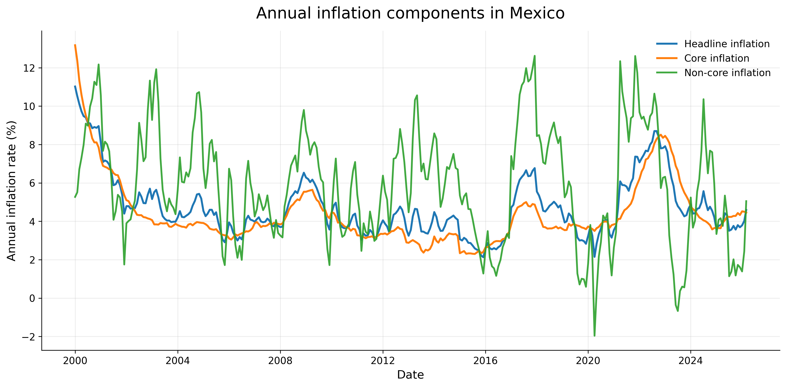
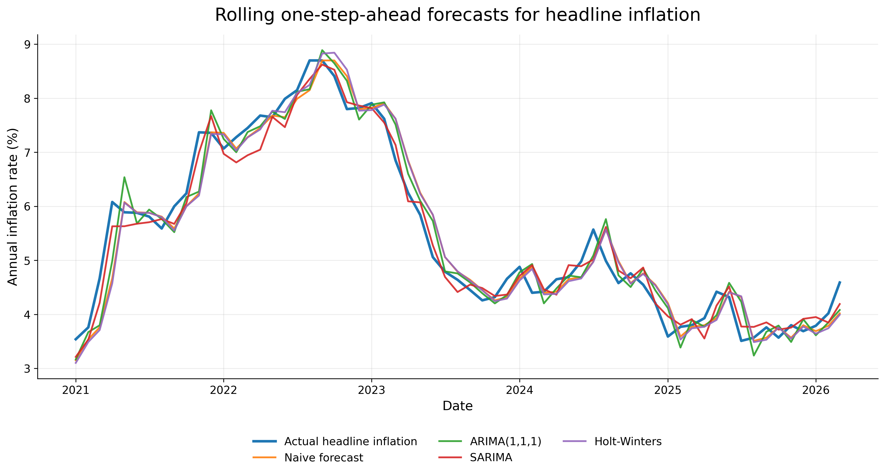

# Mexico inflation: time series and forecasting

A Python project where I download Mexico's monthly inflation from Banco de México's API, compare how its components behave, and test which model forecasts annual headline inflation best one month ahead.



## The question

How has annual inflation in Mexico moved since 2000, and which time series model gives the best short-term forecast of headline inflation?

## What I did

- **Data from the API.** I pulled three monthly series from Banxico's SIE API, from January 2000 to March 2026: headline (`SP30578`), core (`SP74662`) and non-core (`SP74665`) annual inflation.
- **Exploration.** Monthly changes, 3- and 12-month moving averages, volatility by component and the gap between headline inflation and each component.
- **Benchmarks.** A naive forecast (last month's value), a 12-month moving average and simple exponential smoothing.
- **Statistical models.** ARIMA(1,1,1), SARIMA(1,1,1)(1,0,1,12) and Holt-Winters, compared with a rolling one-step-ahead design: for every month from January 2021 to March 2026, each model is refitted with all the data up to the previous month and forecasts the next one.

## Results

| Model | MAE | RMSE | MAPE |
|---|---:|---:|---:|
| SARIMA(1,1,1)(1,0,1,12) | 0.233 | 0.280 | 4.51% |
| ARIMA(1,1,1) | 0.314 | 0.397 | 6.11% |
| Naive forecast | 0.316 | 0.421 | 6.11% |
| Holt-Winters | 0.331 | 0.436 | 6.42% |

- Headline inflation is very persistent, so simply repeating last month's value is already a hard benchmark to beat.
- SARIMA was the only model that clearly beat it, with the lowest error on all three metrics. The seasonal part adds information beyond persistence.
- Core inflation is smoother; non-core is the most volatile component (standard deviation of 2.91 points against 1.68 for core), and it explains most short-term jumps in headline inflation.



The models only use the history of inflation itself. They do not include exchange rates, interest rates, wages or energy prices, so this is a forecasting exercise, not a macroeconomic model.

## How it is organized

- `scripts/01_download_banxico_data.py` to `scripts/05_statistical_forecasting_models.py`: the five steps, from download to the rolling forecast comparison. `scripts/00_search_banxico_inflation_series.py` is the helper I used to find the series IDs.
- `data/`: raw API downloads and the processed monthly dataset.
- `outputs/`: figures, tables and a written summary of the results ([`inflation_forecast_interpretation.md`](outputs/inflation_forecast_interpretation.md)).

## How to reproduce it

You need Python 3 and a free [Banxico SIE API token](https://www.banxico.org.mx/SieAPIRest/service/v1/token). Save it in a `.env` file at the project root as `BANXICO_TOKEN=your_token`, then run:

```sh
python3 -m pip install -r requirements.txt
python3 scripts/01_download_banxico_data.py
python3 scripts/02_prepare_inflation_data.py
python3 scripts/03_exploratory_analysis.py
python3 scripts/04_forecasting_models.py
python3 scripts/05_statistical_forecasting_models.py
```

The downloaded data are already in `data/`, so steps 2 to 5 also run without a token.

## Data source

Banco de México, [Sistema de Información Económica (SIE)](https://www.banxico.org.mx/SieInternet/): annual inflation series `SP30578`, `SP74662` and `SP74665`.

---

Manuel Razo Alcántara · [LinkedIn](https://www.linkedin.com/in/manuel-razo-alcantara) · Code under the [MIT License](LICENSE)
