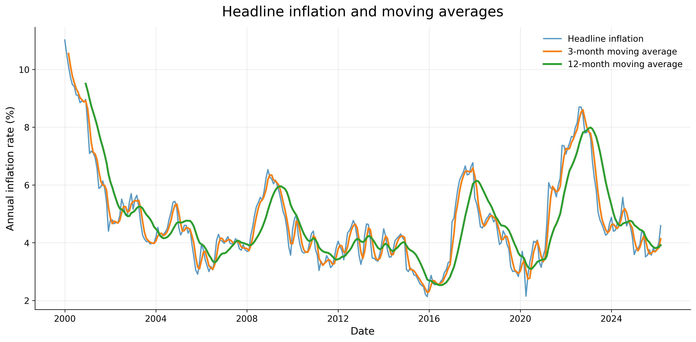
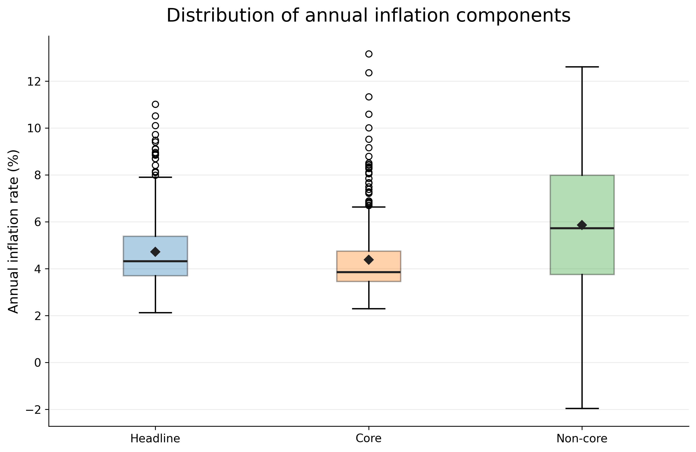
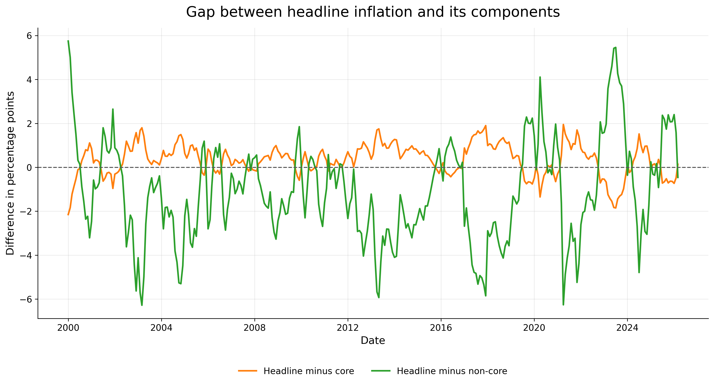
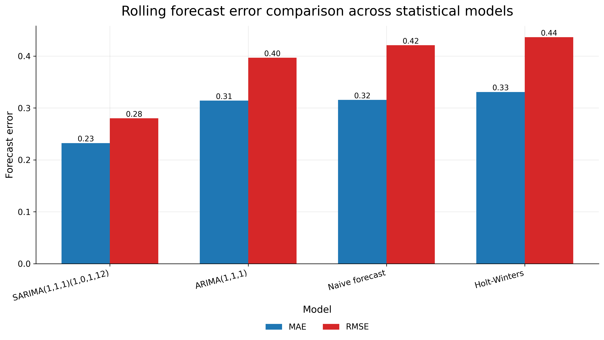
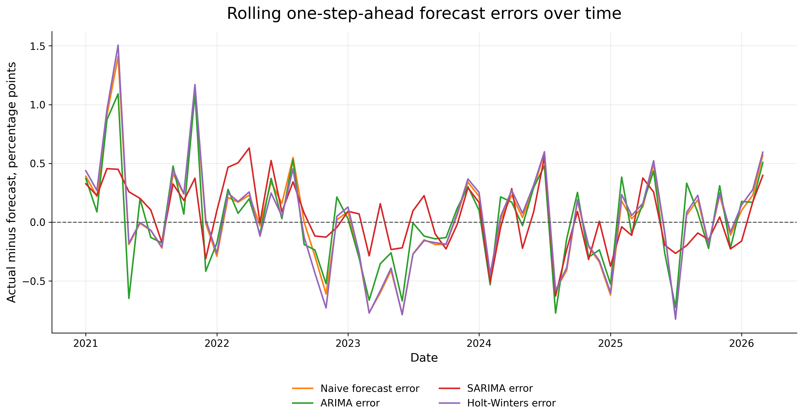

# Mexico Inflation Time Series Forecasting

This project analyzes annual inflation in Mexico using monthly time series data from Banco de México's SIE API.

The objective is to compare headline, core and non-core inflation dynamics, and evaluate different short-term forecasting models for annual headline inflation.

The project includes data extraction from an API, data preparation, exploratory time series analysis, moving averages, volatility comparison, simple forecasting benchmarks and rolling one-step-ahead statistical forecasting.

---

## Project overview

This project focuses on three annual inflation series:

- Headline annual inflation
- Core annual inflation
- Non-core annual inflation

The analysis answers the following question:

> How has annual inflation in Mexico evolved over time, and which time series forecasting approach performs better for short-term headline inflation prediction?

---

## Data source

The data were obtained from Banco de México's Sistema de Información Económica (SIE) API.

The project uses the following series:

| Series ID | Description |
|---|---|
| `SP30578` | Headline annual inflation |
| `SP74662` | Core annual inflation |
| `SP74665` | Non-core annual inflation |

The raw data are downloaded automatically using:

```bash
python3 scripts/01_download_banxico_data.py
```

Raw data are stored in:

```text
data/raw/banxico_inflation_series_long.csv
data/raw/banxico_inflation_metadata.csv
```

---

## Repository structure

```text
time-series-mexico-inflation/
├── data/
│   ├── raw/
│   └── processed/
├── docs/
├── outputs/
│   ├── figures/
│   ├── tables/
│   └── inflation_forecast_interpretation.md
├── scripts/
├── README.md
├── requirements.txt
├── .gitignore
└── LICENSE
```

---

## Methodology

The workflow is divided into five main stages:

1. Download inflation data from Banco de México's API.
2. Prepare a monthly time series dataset.
3. Explore headline, core and non-core inflation dynamics.
4. Compare simple forecasting benchmarks.
5. Evaluate statistical forecasting models using a rolling one-step-ahead design.

---

## Main variables

The processed dataset contains the following variables:

| Variable | Description |
|---|---|
| `date` | Monthly observation date |
| `headline` | Annual headline inflation rate |
| `core` | Annual core inflation rate |
| `non_core` | Annual non-core inflation rate |
| `headline_change` | Monthly change in annual headline inflation |
| `core_change` | Monthly change in annual core inflation |
| `non_core_change` | Monthly change in annual non-core inflation |
| `headline_ma_3` | 3-month moving average of headline inflation |
| `headline_ma_12` | 12-month moving average of headline inflation |

---

## Exploratory analysis

The exploratory analysis compares the behavior of headline, core and non-core annual inflation.

Main findings:

- Core inflation is smoother and more persistent.
- Non-core inflation is more volatile and shows larger swings.
- Headline inflation is strongly related to core inflation, but short-term deviations are often associated with non-core movements.
- Moving averages help distinguish short-term fluctuations from medium-term inflation trends.

---

## Selected figures

### Annual inflation components


### Headline inflation and moving averages



### Distribution of inflation components



### Gap between headline inflation and components



---

## Forecasting models

The project compares simple benchmark models and formal statistical forecasting models.

The final model comparison uses a rolling one-step-ahead forecasting design.

For each month in the test period, each model is fitted using all information available up to the previous month and then used to forecast the next month.

This design is more realistic than a static long-horizon forecast because the model is updated as new observations become available.

---

## Models compared

| Model | Description |
|---|---|
| Naive forecast | Uses the previous month as the forecast |
| ARIMA(1,1,1) | Non-seasonal autoregressive integrated moving-average model |
| SARIMA(1,1,1)(1,0,1,12) | Seasonal ARIMA model with annual monthly seasonality |
| Holt-Winters | Exponential smoothing with trend and seasonality |

---

## Forecast evaluation

The models are evaluated using:

| Metric | Interpretation |
|---|---|
| MAE | Average absolute forecast error |
| RMSE | Forecast error metric that penalizes larger errors more strongly |
| MAPE | Average percentage forecast error |

Lower values indicate better forecasting performance.

---

## Rolling forecast results

| Model | MAE | RMSE | MAPE |
|---|---:|---:|---:|
| SARIMA(1,1,1)(1,0,1,12) | 0.233 | 0.280 | 4.51% |
| ARIMA(1,1,1) | 0.314 | 0.397 | 6.11% |
| Naive forecast | 0.316 | 0.421 | 6.11% |
| Holt-Winters | 0.331 | 0.436 | 6.42% |

The SARIMA model achieved the lowest forecast error across all three metrics.

This suggests that incorporating seasonal structure improves short-term forecasting performance for annual headline inflation.

---

## Forecasting figures

### Rolling forecast comparison


### Forecast error comparison



### Forecast errors over time



---

## Key findings

- Annual headline inflation in Mexico shows strong persistence over time.
- Core inflation is smoother than non-core inflation.
- Non-core inflation is the most volatile component.
- The naive forecast is a strong short-term benchmark.
- SARIMA outperformed ARIMA, Holt-Winters and the naive benchmark under a rolling one-step-ahead evaluation.
- The rolling evaluation design provides a more realistic assessment of short-term forecasting performance.

---

## Limitations

This project focuses on univariate time series forecasting using inflation history only.

The models do not include external explanatory variables such as interest rates, exchange rates, wages, energy prices or monetary policy indicators.

Therefore, the results should be interpreted as a statistical forecasting exercise rather than a full macroeconomic forecasting system.

---

## Possible extensions

Future improvements could include:

- SARIMAX models with exogenous variables
- Forecasting core and non-core inflation separately
- Automatic ARIMA order selection
- Forecast intervals
- Rolling evaluation with alternative training windows
- Comparison with exchange rate, policy rate or energy price series
- VAR models or machine learning forecasting models

---

## How to reproduce

Install the required packages:

```bash
python3 -m pip install -r requirements.txt
```

Run the scripts in order:

```bash
python3 scripts/01_download_banxico_data.py
python3 scripts/02_prepare_inflation_data.py
python3 scripts/03_exploratory_analysis.py
python3 scripts/04_forecasting_models.py
python3 scripts/05_statistical_forecasting_models.py
```

The outputs will be saved in:

```text
outputs/figures/
outputs/tables/
```

---

## Main outputs

### Reports

```text
outputs/inflation_forecast_interpretation.md
outputs/forecast_model_summary.txt
outputs/rolling_statistical_forecast_model_summary.txt
```

### Processed data

```text
data/processed/inflation_monthly_processed.csv
```

### Forecast comparison table

```text
outputs/tables/rolling_statistical_forecast_model_comparison.csv
```

---

## Tools used

- Python
- pandas
- NumPy
- matplotlib
- statsmodels
- requests
- python-dotenv
- Banco de México SIE API
- Git / GitHub

---

## Author

Manuel Razo Alcántara  
Actuarial Science student, Facultad de Ciencias, UNAM